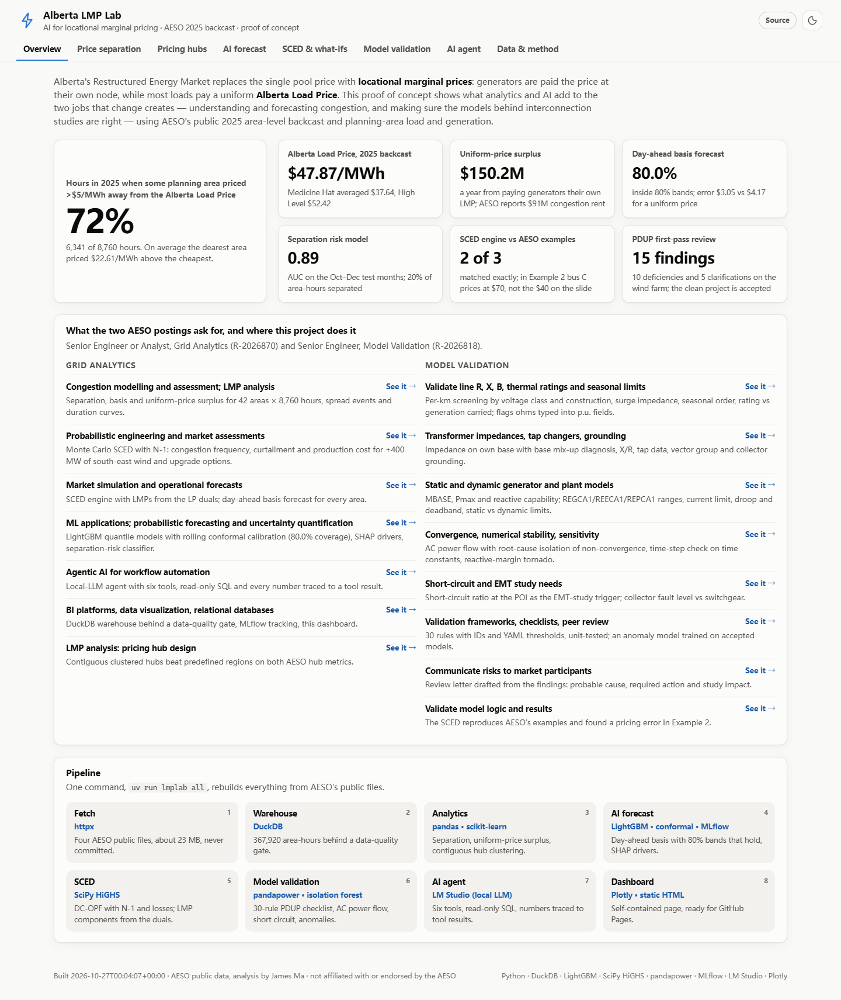
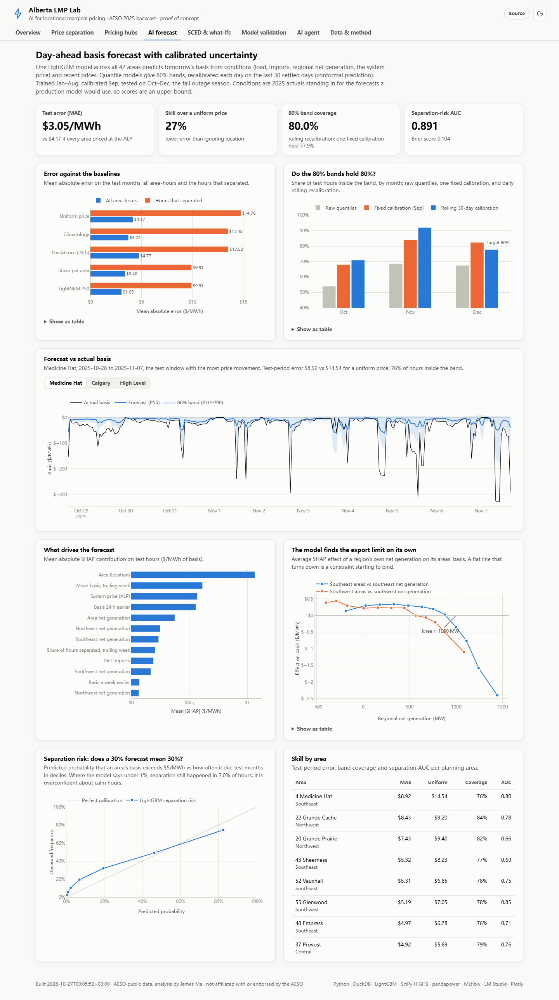
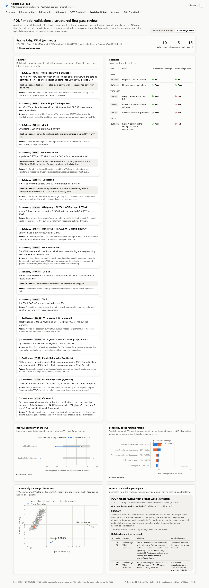
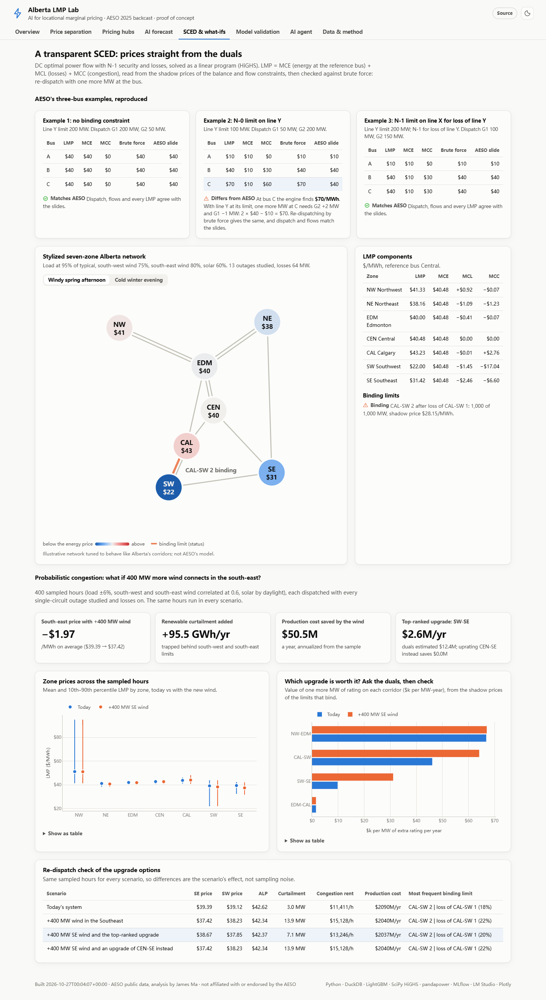
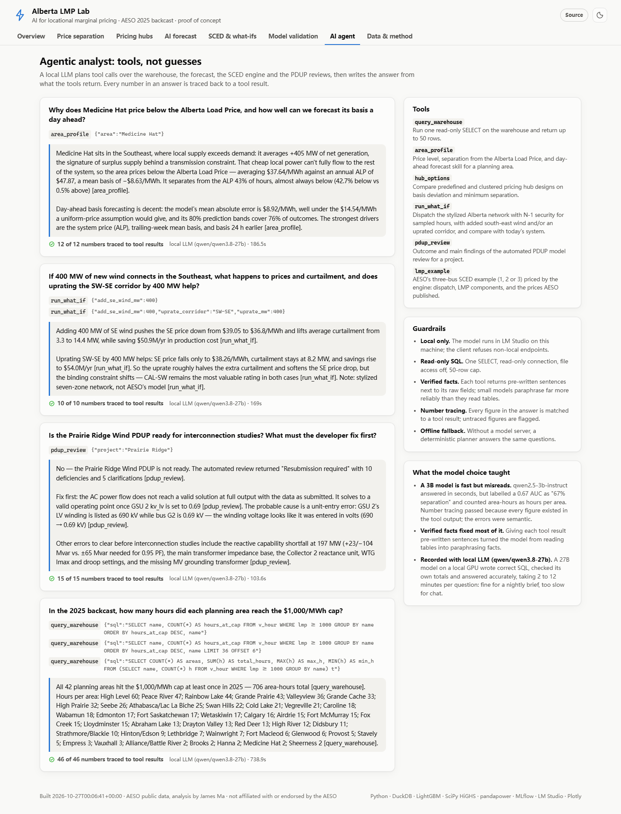

# Alberta LMP Lab: AI for locational marginal pricing

Alberta's Restructured Energy Market replaces the single pool price with **locational marginal
prices (LMPs)**: generators are paid the price at their own node, while most loads pay a uniform
**Alberta Load Price (ALP)**. This proof of concept shows what analytics and AI add to the two jobs
that change creates: understanding and forecasting congestion, and making sure the models behind
interconnection studies are right. It runs end to end on AESO's public 2025 area-level backcast
LMPs and planning-area load and generation.

**Dashboard:** `site/index.html` (a self-contained page; published with GitHub Pages).



<p>
  
  
</p>
<p>
  
  
</p>

More: [price separation](docs/img/separation-light.png) · [pricing hubs](docs/img/hubs-light.png).

| | What is built | Result |
|---|---|---|
| Congestion analytics | DuckDB warehouse behind a data-quality gate; basis, separation and uniform-price surplus for 42 areas x 8,760 hours | Some area priced more than $5/MWh from the ALP in **72% of hours**; paying generators their own LMP leaves a **$150.2M** surplus (AESO reports $91M of congestion rent, which excludes loss rent) |
| Pricing hubs | Contiguous Ward clustering of hourly price series, at least three areas per hub | Clustered hubs beat predefined planning-region hubs on **both** AESO hub metrics at every hub count |
| Day-ahead basis forecast | One LightGBM model for all areas; quantile models with **rolling conformal calibration**; SHAP drivers; separation-risk classifier; MLflow tracking | Test error **$3.05/MWh vs $4.17** for a uniform price (27% better); 80% bands cover **80.0%** of test hours; separation AUC **0.89** |
| SCED engine | DC optimal power flow with N-1 security and losses (SciPy HiGHS); LMP = MCE + MCL + MCC read from the duals and checked by brute-force re-dispatch | Reproduces AESO's three-bus Examples 1 and 3 exactly; finds that Example 2's bus C prices at **$70/MWh, not the $40** on the slide |
| Probabilistic what-ifs | Monte Carlo SCED on a stylized seven-zone Alberta network | +400 MW of south-east wind: SE price -$1.97/MWh, +95.5 GWh/yr curtailment, -$50.5M/yr production cost; the dual-ranked upgrade (SW-SE) saves $2.6M/yr, the intuitive one (CEN-SE) **$0** |
| PDUP model validation | 30-rule checklist (data, topology, lines, transformers, generators, WECC dynamic models), AC power flow and short circuit (pandapower), sensitivity, an isolation forest trained on accepted models, an auto-drafted review letter | On a synthetic wind farm with typical data errors: **10 deficiencies and 5 clarifications**, every injected error found with its probable cause; non-convergence traced to a single typo; the clean solar-plus-storage project passes |
| Agentic analyst | Local LLM (LM Studio) planning calls over six tools: read-only SQL, area profiles, hub designs, SCED what-ifs, PDUP reviews, AESO examples | Answers built from verified tool facts; **every number traced** to a tool result; deterministic fallback offline |

## Built for two AESO roles

**Senior Engineer or Analyst, Grid Analytics (R-2026870)**: congestion modelling and assessment,
LMP analysis, market simulation, operational forecasts, probabilistic assessments, ML and agentic AI,
BI dashboards and relational databases. See the *Price separation*, *Pricing hubs*, *AI forecast*,
*SCED & what-ifs* and *AI agent* tabs.

**Senior Engineer, Model Validation (R-2026818)**: reviewing PDUPs; validating line R, X, B, thermal
and seasonal ratings, transformer impedances, taps and grounding, static and dynamic generator models;
convergence, numerical stability and sensitivity; checklists; communicating risk to market
participants. See the *Model validation* tab and `pdup/`.

## Findings worth discussing

1. **A pricing error in a published example.** In AESO's Example 2 (line Y limited to 100 MW), serving
   one more MW at bus C needs G2 +2 MW and G1 -1 MW, so the LMP at C is 2 x $40 - $10 = **$70/MWh**,
   not $40. Dispatch and flows match the slide; only that price differs. The test suite pins this down
   (`tests/test_sced.py`).
2. **Static calibration fails under drift.** Conformal intervals calibrated once on September covered
   78% of October-December hours, and only 68% in October, the outage season. Recalibrating each day
   on the last 30 settled days brings the test period to 80.0%.
3. **The model finds the export limit on its own.** The SHAP dependence of south-east basis on
   south-east net generation is flat, then turns down past about 1 GW: an export constraint starting to
   bind, learned from prices alone.
4. **Duals rank upgrades, re-dispatch prices them.** Shadow prices put a first-order value of $12.4M/yr
   on uprating SW-SE by 400 MW; re-dispatch finds $2.6M, because the next limit binds. With parallel
   circuits the duals are degenerate: uprating one circuit of a pair only moves the N-1 limit to its twin,
   so screening runs per corridor.
5. **Converged is not valid.** The wind farm's case does not solve as submitted. Re-solving with each
   suspected correction on its own isolates the cause, a 0.69 kV winding typed as 690, and a plausibility
   check rejects "solutions" that converge to absurd voltages.
6. **Model size matters for agents.** A 3B local model answered in seconds but misread fields (an AUC of
   0.67 became "67% separation"); number tracing passed because the number existed. Verified fact
   sentences in every tool result fixed most of it; a 27B model on a local GPU answered every demo
   question correctly, taking 2 to 12 minutes each (the 42-row answer took longest).

## Quick start

```bash
uv sync
uv run lmplab all --no-llm      # fetch (23 MB from AESO), ingest, analyze, forecast, sced, pdup, agent, report
```

Steps also run one at a time (`uv run lmplab fetch`, `ingest`, `analyze`, `forecast`, `sced`, `pdup`,
`agent`, `report`). Ask the agent a question with `uv run lmplab ask "..."`. For the LLM paths, start
LM Studio's server with a chat model loaded (set `LLM_CHAT_MODEL` to pick one); without it, every step
falls back to its offline path. Tests: `uv run pytest` (49 tests).

## Data

AESO public files, downloaded by `lmplab fetch` and never committed:

- *2025 Area-Level Backcast LMP* (AESO Engage, LMP stakeholder materials, September 2026)
- *Planning Area: Hourly Load and Generation, 2025* (AESO data requests)
- *Locational Marginal Pricing stakeholder session deck*, 14 September 2026 (AESO Engage)
- *AESO transmission planning areas and regions* map

The committed `artifacts/reports/` (derived results) and `site/` (the dashboard) let a fresh clone
show everything without downloading. AESO data are used under AESO's terms of use. This project is
independent and is not affiliated with or endorsed by the AESO.

## Layout

```
configs/            pipeline settings; the stylized seven-zone network (alberta7.yaml)
pdup/               PDUP screening thresholds (rules.yaml) and two synthetic submissions
src/lmplab/
  ingest.py         AESO files -> DuckDB with data-quality checks
  analytics.py      separation, surplus, events, pricing hubs
  forecast.py       LightGBM quantiles, rolling conformal calibration, SHAP, MLflow
  sced.py           SCED / DC-OPF with N-1 and losses; AESO's three-bus examples
  grid.py           Monte Carlo what-ifs and dual-based upgrade screening
  pdup.py           the model validation checklist, power flow, short circuit, anomalies, letters
  agent.py, llm.py  tool-calling agent on a local LLM, with grounding checks
  report/           the static dashboard
tests/              49 tests
```

## Limits

- **Area level, not nodal.** One LMP per planning area; AESO's hub analysis uses bus-level prices, so
  basis deviations here run higher.
- **Forecast inputs are actuals.** Load, generation and the system price are 2025 actuals standing in
  for the forecasts a production model would use; scores are an upper bound.
- **Stylized network.** The seven-zone SCED studies are illustrative, tuned to behave like Alberta's
  corridors, not AESO's PSS/E model.
- **Synthetic PDUPs.** Both submissions, the screening ranges and the accepted-model library are
  invented; real reviews follow AESO's PDUP checklist, data forms and ISO rules.
- **YAML, not PSS/E files.** Submissions are YAML stand-ins for the PSS/E RAW and DYR files and AESO
  data forms a real PDUP carries; the checks are format-independent, and a production version would
  read the case files directly and run AESO's dynamic model performance test bench.
